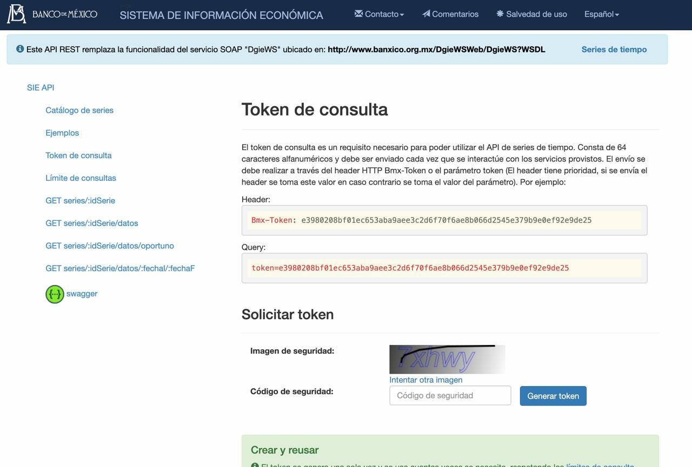

# César Segura Landa · E-commerce con Laravel 12 + Livewire 3

E-commerce simplificado con panel de administración, desarrollado como evaluación técnica para **Programador Full Stack**.

Incluye catálogo, carrito, cotización y generación de pre-pedidos con pago simulado, tipo de cambio en tiempo real desde **Banxico** con caché en **Redis**, kardex de precios e inventario, y reportes de ventas y ganancias.

## Stack

| Tecnología | Versión |
|---|---|
| PHP | 8.4 |
| Laravel | 12.70 |
| Livewire | 3.8 (con Alpine.js incluido) |
| Laravel Breeze | 2.4 (autenticación, stack Livewire) |
| Spatie Laravel Permission | 8.3 |
| Tailwind CSS | 3 |
| MySQL | 8+ |
| Redis | 7+ (cliente Predis 3.7) |
| Chart.js | 4 |

## Funcionalidades

### Administración
- **Login** con Laravel Breeze. Solo el personal con rol entra al panel; los clientes se redirigen a la tienda (middleware `staff`).
- **Roles y permisos** con Spatie: `SuperAdministrador` y `Administrativo`, con permisos por acción (`products.create`, `products.edit`, etc.), validados en la ruta y en cada acción.
- **Dashboard** con ventas, pedidos, productos activos, stock bajo y tipo de cambio vigente.
- **CRUD de productos** con búsqueda, filtros y paginación en tiempo real; detalle, alta y edición con validación en vivo; imagen con vista previa; activar/inactivar; **eliminación lógica (soft deletes)**.
- **Kardex de precios e inventario** automático (eventos del modelo).
- **Tipo de cambio**: histórico consultado a Banxico.
- **Pedidos** con filtro por rango de fechas, estatus y búsqueda, con detalle desplegable.
- **Reportes**: gráfica de ventas y ganancias por día o mes, indicadores y **top 3 de productos más vendidos**.

### Tienda
- **Catálogo** solo con productos activos, vigentes y no eliminados; filtros sin recargar por búsqueda, categoría, rango de precio (MXN) y disponibilidad.
- **Detalle de producto** con SKU, imagen, descripciones y precio en USD y MXN.
- **Carrito** en sesión (Redis): agregar, modificar cantidades respetando el stock y eliminar.
- **Cotización / checkout**: productos, subtotal, IVA 16 % y total en MXN y USD; correo del comprador; login o registro antes de pagar.
- **Pago simulado** (aprobado / rechazado) antes de generar el pedido.
- **Mis pedidos** para el cliente.

## Requisitos

- PHP 8.2+ (probado con 8.4)
- Composer 2
- Node.js 20+ y npm
- MySQL 8+
- Redis en el puerto 6379
- Token gratuito de la API SIE de Banxico

## Instalación

```bash
git clone git@github.com:SLC-404/cesar-segura-landa.git
cd cesar-segura-landa

composer install
npm install

cp .env.example .env
php artisan key:generate
```

Obtén tu token gratuito de Banxico:

1. Entra a https://www.banxico.org.mx/SieAPIRest/service/v1/token
2. En **Solicitar token**, escribe el código de la imagen de seguridad y da clic en **Generar token**.
3. Copia el token de 64 caracteres.



Configura en el `.env` la base de datos y el token:

```env
APP_URL=http://tienda.test

DB_DATABASE=devtest
DB_USERNAME=root
DB_PASSWORD=

CACHE_STORE=redis
SESSION_DRIVER=redis
REDIS_CLIENT=predis

BANXICO_TOKEN=tu_token_de_banxico
```

Crea las tablas, carga los datos de prueba y consulta el tipo de cambio:

```bash
php artisan migrate --seed
php artisan storage:link
php artisan exchange-rate:update
```

Compila los assets:

```bash
npm run dev
```

## Virtual host: `http://tienda.test`

**Con Laravel Herd** (desde la carpeta del proyecto):

```bash
herd link tienda
```

**Con Laragon (Windows):** coloca el proyecto en `C:\laragon\www\tienda` y reinicia Laragon; el virtual host `http://tienda.test` se crea automáticamente.

**Sin Herd ni Laragon:** agrega esta línea al archivo `hosts` (`/etc/hosts` en Mac/Linux o `C:\Windows\System32\drivers\etc\hosts` en Windows):

```
127.0.0.1   tienda.test
```

y levanta el servidor con:

```bash
php artisan serve --host=tienda.test --port=8000
```

## Tareas programadas

El tipo de cambio se actualiza solo todos los días a las **00:01** (con reintento a las 06:00). En desarrollo:

```bash
php artisan schedule:work
```

En producción, agrega al cron del servidor:

```
* * * * * cd /ruta/del/proyecto && php artisan schedule:run >> /dev/null 2>&1
```

## Credenciales de prueba

| Rol | Correo | Contraseña |
|---|---|---|
| SuperAdministrador | `admin@gmail.com` | `SVLgYyxTiy.6` |
| Cliente | Regístrate desde la tienda con "Crear cuenta" | — |

### Tarjetas del pago simulado

| Tarjeta | Resultado |
|---|---|
| `4242424242424242` (o cualquiera de 16 dígitos) | ✅ Aprobado |

Vencimiento futuro en formato `MM/AA` y CVV de 3 dígitos.

## Servicios externos

### Banxico SIE (tipo de cambio)

1. Obtén un token gratuito (ver [Instalación](#instalación)).
2. Agrégalo al `.env` como `BANXICO_TOKEN`.

- **Serie `SF60653`:** tipo de cambio **DOF**, el vigente para solventar obligaciones en dólares y el que pide el SAT para CFDI (en lugar del FIX del día).
- **Endpoint:** `GET /SieAPIRest/service/v1/series/SF60653/datos/oportuno`, con el header `Bmx-Token`.
- **Caché en Redis:** `ExchangeRateService::current()` lee de Redis → BD → Banxico. La clave expira a la medianoche, así que la API se consulta una vez al día.
- **Histórico** en la tabla `exchange_rates`, con `base_currency` y `quote_currency` (lista para más monedas).
- **Comando** `php artisan exchange-rate:update`: guarda el tipo de cambio y recalcula el `price_mxn` de todos los productos en una sola transacción. Si Banxico falla, se conserva el último valor y se registra en el log.

### Pago simulado

`PaymentService` actúa como una pasarela (mock): recibe el monto y la tarjeta, simula la latencia y responde aprobado o rechazado con una referencia `SIM-XXXXXXXXXX`. No requiere credenciales. Los datos de la tarjeta no se guardan; el log solo registra los últimos 4 dígitos.

## Equivalencias con el requerimiento

El modelo de datos está en inglés:

| Requerimiento | Implementación |
|---|---|
| `productos` | `products` |
| `pedidos` | `orders` |
| `pedido_detalle` | `order_details` |
| `precio_usd` / `precio_mxn` | `price_usd` / `price_mxn` |
| `descripcion_corta` / `descripcion_larga` | `short_description` / `long_description` |
| `fecha_vigencia` | `valid_until` |
| `activo` | `is_active` |
| `correo` / `impuestos` / `estatus` / `fecha` | `email` / `taxes` / `status` / `ordered_at` |

Tablas adicionales: `categories`, `clients`, `quotes`, `quote_items`, `exchange_rates`, `kardex_prices`, `kardex_inventories` y las de Spatie.

## Decisiones técnicas y supuestos

- **Categorías:** tabla `categories` agregada para el filtro del catálogo.
- **Precio en MXN:** se captura en USD y la aplicación calcula el MXN con el tipo de cambio vigente; se guarda en la tabla para filtrar y ordenar por precio en SQL.
- **Costo de compra (`cost_usd`):** agregado para calcular la **ganancia real** de los reportes.
- **Precios congelados:** `order_details` y `quote_items` guardan precio, costo y tipo de cambio del momento.
- **Carrito en sesión (Redis):** funciona sin login, solo guarda `id => cantidad` y lee precio y stock frescos de la BD; se autolimpia si un producto deja de estar disponible.
- **Cotizaciones:** al llegar al checkout, el carrito se guarda como cotización. Al pagar, se crea el pedido y la cotización se liga con `order_id` (no se elimina), para medir conversión y carritos abandonados.
- **Clientes:** se requiere cuenta para comprar; son usuarios **sin rol** con un perfil en `clients`. El correo se toma de la cuenta y es editable en el checkout.
- **Pedido en transacción** con `lockForUpdate()`: evita vender más piezas que el stock si 2 clientes compran al mismo tiempo. El folio `PED-AAAAMMDD-000001` se basa en el id.
- **Pago rechazado:** no se crea pedido; la cotización queda abierta para reintentar.
- **Ventas** = subtotal sin IVA de pedidos pagados. **Ganancia** = (precio MXN − costo USD × tipo de cambio del pedido) × cantidad.
- **Soft deletes en `products`** (requerimiento); los pedidos no se borran, se manejan por estatus.
- **Regla de "producto a la venta"** centralizada en el scope `available()` (catálogo, detalle y carrito).

## Mejoras futuras

- Modulo de pagos real con tokenización y reembolso automático si el stock se agota después del cobro.
- Correo de confirmación del pedido.
- Carrito persistente por usuario.
- Promociones, cupones y descuentos.
- CRUD de categorías, usuarios y roles; vistas del kardex.
- Gráfica del histórico del tipo de cambio y más monedas.
- Pruebas automatizadas (Pest).

## Flujo de Git

- `main`: versión entregada (`v1.0.0`).
- `develop`: integración.
- `feature/*`,`docs/*`: una rama por cambio, integrada a `develop`.

**César Segura Landa** · [github.com/SLC-404](https://github.com/SLC-404)
